<!-- Repo name must exactly match your GitHub username, and be public. -->
<!-- Replace YOUR-USERNAME, YOUR-REPO, YOUR-COLLEGE, and the contact links. -->

## About

I'm Puneet Singh, a data science student who likes turning messy data into clear answers. I enjoy breaking a problem into smaller parts, testing different approaches, and explaining what the numbers actually say. I'm building my portfolio one end-to-end project at a time.

**Education:** B.Tech / CSE-DS, Noida Institute of Engineering and Technology

## Selected project

### Sales Forecasting

A sales analysis project: it studies three years of daily sales, breaks them into trend, weekly and yearly patterns, and compares three approaches to predict future sales on a held-out 60-day test window.

| Model | MAE | RMSE | MAPE (%) |
|---|---|---|---|
| ARIMA | 100.67 | 131.51 | 9.53 |
| **Additive Regression** | **80.36** | **108.29** | **7.60** |
| Neural Network (MLP) | 115.31 | 141.90 | 11.07 |

- Dataset: three years of daily e-commerce sales (2023-2025) with trend, weekly and yearly seasonality, promotions and noise.
- Takeaway: additive regression won because its explicit yearly-seasonality term anticipates the holiday-season spike in the test window.
- Pipeline: data generation, seasonal decomposition, model training, evaluation and plots.

**Tech:** Python, NumPy, pandas, Matplotlib, scikit-learn

[View repository](https://github.com/YOUR-USERNAME/YOUR-REPO)

Plots

## Skills

| Area | Tools |
|---|---|
| Language | Python |
| Data | NumPy, pandas |
| Machine learning | scikit-learn, ARIMA, regression, MLP |
| Visualization | Matplotlib |
| Tools | Git, GitHub |

## GitHub activity

## Connect

[GitHub](https://github.com/YOUR-USERNAME) | [LinkedIn](https://linkedin.com/in/YOUR-HANDLE) | [Email](mailto:YOUR-EMAIL)

